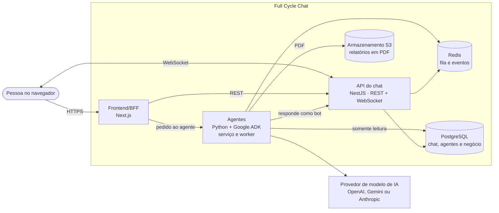

# Full Cycle Chat


Um chat de equipe no estilo Slack, com canais, conversas 1:1, menções, tarefas e notificações em
tempo real, em que **agentes de IA entram como plugins**. Basta mencionar o `@assistente` na
conversa para ele resumir o que aconteceu, delegar uma tarefa para alguém ou responder perguntas
sobre os números do negócio direto do banco de dados da empresa.

> 🚧 **Em construção, aula a aula.** O produto está especificado por inteiro em `docs/`, e o código
> avança a cada aula da imersão. Veja o [roadmap](#-roadmap-por-aula) para saber o que já existe.

## O que o produto promete

- 💬 **A IA fica dentro da conversa.** Mencione o agente em qualquer canal ou conversa direta; o
  pedido e a resposta ficam ali mesmo, sem trocar de ferramenta.
- ✅ **O agente executa ações.** A delegação vira uma tarefa de verdade, com responsável e
  notificação, e o relatório de dados chega como PDF para baixar.
- 🔐 **Dados de negócio com permissão.** O agente só consulta dados quando quem pediu tem acesso, e
  nunca altera os dados da empresa.
- 🎯 **O agente não inventa.** Todo número precisa estar no resultado de uma consulta. Quando não
  consegue responder, ele diz que não conseguiu.
- 🔌 **Agentes são plugins.** Um administrador conecta e desconecta cada agente do workspace.

Os detalhes de escopo, público e métricas estão no [product brief](docs/product-brief.md).

## 🏗️ Arquitetura

Um monorepo com três aplicações: o frontend/BFF em Next.js, a API do chat em NestJS e os agentes em
Python com Google ADK. A ideia central é o **chat não depender dos agentes**: o BFF dispara o
agente, e o agente devolve o resultado à conversa como um bot, pela mesma API que as pessoas usam.



O diagrama completo, os fluxos e as decisões estão no [HLD](docs/hld.md).

## 🗺️ Roadmap por aula

Cada aula tem a sua branch e tags marcando onde começou e onde parou. Para ver o código como estava
ao fim de uma aula, faça checkout da tag ou da branch dela.

| Aula | O que foi feito | Onde ver |
| --- | --- | --- |
| 01 | Do zero à base do projeto: product brief, HLD, LLD e ADRs escritos com IA; projetos Next.js e NestJS criados; ambiente de desenvolvimento no Docker; `AGENTS.md`, rules e skills para guiar os agentes de código | Branch [`feature/aula-01`](https://github.com/devfullcycle/imersao-ia1/tree/feature/aula-01) · tags [`aula-01-inicio`](https://github.com/devfullcycle/imersao-ia1/tree/aula-01-inicio) e [`aula-01-fim`](https://github.com/devfullcycle/imersao-ia1/tree/aula-01-fim) |
| 02 | Do planejamento ao chat completo: roadmap, design system e as skills de PRD, plano de tarefa e TDD; depois, as funcionalidades [F01 a F09](docs/roadmap.md), cada uma com PRD, spec e tarefas: login e sessão, mensagens em canal público, tempo real, criação de canais e canal privado, perfil e conversa direta, ações na mensagem, não lidas e menções, notificações e Atividade, perfil e tema | Branch [`feature/aula-02`](https://github.com/devfullcycle/imersao-ia1/tree/feature/aula-02) · tags [`aula-02-inicio`](https://github.com/devfullcycle/imersao-ia1/tree/aula-02-inicio) e [`aula-02-fim`](https://github.com/devfullcycle/imersao-ia1/tree/aula-02-fim) |
| 03 | Os agentes de IA: o Serviço de agentes em Python com o Google ADK e o worker do relatório; depois, as funcionalidades [F10 a F14](docs/roadmap.md): conexão de agentes, resumo de conversa pelo agente, delegação de Tarefa pelo agente, consulta a dados de negócio e relatório em PDF | Branch [`feature/aula-03`](https://github.com/devfullcycle/imersao-ia1/tree/feature/aula-03) · tags [`aula-03-inicio`](https://github.com/devfullcycle/imersao-ia1/tree/aula-03-inicio) e [`aula-03-fim`](https://github.com/devfullcycle/imersao-ia1/tree/aula-03-fim) |

## ▶️ Como executar

**Pré-requisito:** [Docker](https://docs.docker.com/get-docker/) com Docker Compose. Tudo roda
dentro dos contêineres, então você não precisa de Node.js, pnpm, Python nem uv instalados na
máquina.

```bash
git clone https://github.com/brenofelips/imersao-ia.git
cd imersao-ia

# Sobe os contêineres e espera o Postgres e o S3 ficarem prontos
docker compose -f compose.yaml up -d --build --wait
```

Na primeira subida, a instalação das dependências continua dentro dos contêineres por alguns
minutos. Acompanhe com `docker compose -f compose.yaml logs -f web chat-api agents` e, quando terminar,
rode a web, a API e o Serviço de agentes (cada um num terminal):

```bash
docker compose -f compose.yaml exec web pnpm dev --hostname 0.0.0.0
docker compose -f compose.yaml exec chat-api pnpm start:dev
docker compose -f compose.yaml exec agents uv run uvicorn app.fast_api_app:app --host 0.0.0.0 --port 8000
```

O agente de exemplo chama o Gemini: copie `apps/agents/.env.example` para `apps/agents/.env` e
preencha a `GEMINI_API_KEY`.

| Serviço | Endereço |
| --- | --- |
| Web (Next.js) | <http://localhost:3000> |
| API do chat (NestJS) | <http://localhost:3001> |
| Serviço de agentes (Google ADK) | <http://localhost:3002> |
| PostgreSQL | `localhost:5432` |
| S3 (SeaweedFS) | <http://localhost:8333> |

Para derrubar: `docker compose -f compose.yaml down`.

Recomeçar do zero, resolver falha na instalação e os comandos de teste e lint de cada aplicação
estão no [`AGENTS.md`](AGENTS.md), em [`apps/chat-api/AGENTS.md`](apps/chat-api/AGENTS.md), em
[`apps/web/AGENTS.md`](apps/web/AGENTS.md) e em [`apps/agents/AGENTS.md`](apps/agents/AGENTS.md).

## 🤖 Como este projeto foi construído com IA

Este repositório não começou pelo código. Antes de qualquer linha, o produto e a arquitetura foram
escritos em documentos, com a IA conduzindo entrevistas e registrando as decisões. Depois, esses
documentos viraram o contexto que guia os agentes de código.

1. **Product brief por entrevista.** A skill `product-brief` entrevista a pessoa, seção por seção,
   e grava o [`docs/product-brief.md`](docs/product-brief.md): o quê, para quem, o que fica fora
   do MVP.
2. **HLD.** A skill `hld` transforma o brief na arquitetura de alto nível
   ([`docs/hld.md`](docs/hld.md)): contêineres, fluxos, requisitos de qualidade.
3. **LLD e ADRs.** A skill `lld` desce aos detalhes ([`docs/lld.md`](docs/lld.md)): rotas, tabelas,
   regras. Cada decisão importante vira um ADR em [`docs/adr/`](docs/adr/).
4. **`AGENTS.md` e rules.** Os comandos, a forma de rodar no Docker e as práticas de código de cada
   aplicação ficam em arquivos de memória que o agente lê antes de trabalhar.
5. **Código.** Só então o agente escreve código, com as skills de boas práticas da stack carregadas.

Skills usadas no projeto (ficam em `.claude/skills/`):

| Skill | Para quê | Origem |
| --- | --- | --- |
| `product-brief` | Entrevista e grava o product brief | Própria do projeto |
| `hld` | Cria, revisa e atualiza o HLD | Própria do projeto |
| `lld` | Cria, revisa e atualiza o LLD | Própria do projeto |
| `domain-modeling` | Glossário do domínio e ADRs | [mattpocock/skills](https://github.com/mattpocock/skills) |
| `grill-me`, `grilling`, `grill-with-docs` | Entrevistas para testar ideias e planos | [mattpocock/skills](https://github.com/mattpocock/skills) |
| `nestjs-best-practices` | Boas práticas de NestJS | [kadajett/agent-nestjs-skills](https://github.com/kadajett/agent-nestjs-skills) |
| `next-best-practices` | Boas práticas de Next.js | [vercel-labs/openreview](https://github.com/vercel-labs/openreview) |
| `vercel-react-best-practices` | Performance em React e Next.js | [vercel-labs/agent-skills](https://github.com/vercel-labs/agent-skills) |

## 🎨 Design no Figma

O design completo do Full Cycle Chat está no arquivo [`slack.fig`](slack.fig), na raiz do repositório.
Para abrir, baixe o arquivo e importe no Figma: arraste o `.fig` para a tela inicial do Figma ou use a
opção de importar arquivo.

Os tokens, os componentes e as regras que o código segue a partir desse design estão no
[`docs/design-system.md`](docs/design-system.md).

## 📚 Onde ler o quê

| Documento | O que tem |
| --- | --- |
| [`docs/product-brief.md`](docs/product-brief.md) | O quê e para quem: escopo do MVP, o que fica fora, métricas |
| [`docs/hld.md`](docs/hld.md) | Arquitetura de alto nível: contêineres, fluxos, requisitos |
| [`docs/lld.md`](docs/lld.md) | Detalhes de implementação: rotas, tabelas, regras |
| [`docs/adr/`](docs/adr/) | As decisões de arquitetura, uma por arquivo |
| [`docs/roadmap.md`](docs/roadmap.md) | As funcionalidades a desenvolver, as dependências e o status de cada uma |
| [`GLOSSARY.md`](GLOSSARY.md) | O vocabulário do domínio |
| [`slack.fig`](slack.fig) | O design do Full Cycle Chat no Figma |
| [`AGENTS.md`](AGENTS.md) | Como rodar o projeto e as convenções para agentes de código |

## Licença

Distribuído sob a licença MIT. Veja o arquivo [`LICENSE`](LICENSE).

## Autor

<table>
  <tr>
    <td align="center">
      <a href="https://github.com/brenofelips">
        <br />
        <b>Breno Felipes</b>
      </a>
      <br />
      <a href="https://github.com/brenofelips">GitHub</a> ·
      <a href="https://www.linkedin.com/in/felipsbreno/">LinkedIn</a>
    </td>
  </tr>
</table>
